**❗️项目声明：本项目为开源的数字商品商城系统，仅供学习、研究与合法业务使用。请遵守所在地法律法规及支付服务商规则；项目作者及贡献者不对使用本项目开展的第三方交易、内容或服务承担责任。遇到问题请通过 GitHub 提交 `issue`，请勿将开源项目用于违法违规用途。**

---

# MioKey

<p align="center">
  <br>
  基于 Cloudflare Workers 的轻量级数字商品商城与管理后台
</p>

<p align="center">
  <a href="https://github.com/mio-co/MioKey/blob/main/LICENSE"></a>
</p>

## 🪧 介绍

MioKey 是一个运行在 **Cloudflare Workers** 上的数字商品商城（发卡）系统，集成商品展示、订单支付、自动发卡、人工与实物发货、用户账户、消息推送及运营后台，使用 Cloudflare D1 保存数据。

MioKey 在 [34892002/cffk](https://github.com/34892002/cffk) 的基础上重做了前台商城与管理后台的界面和交互（参见 [基于 34892002/cffk 修改](#-基于-34892002cffk-修改)），支付、订单、发卡、认证、数据库等服务端逻辑与上游保持一致，方便后续同步上游更新。

[一键免费部署到 Cloudflare Workers。](#-一键部署到-cloudflare-workers)

## 页面展示

> 截图来自本地演示数据（MioKey Demo），桌面 1440px / 手机 iPhone 12。

### 前台商城

| 桌面 | 手机 |
| --- | --- |
| 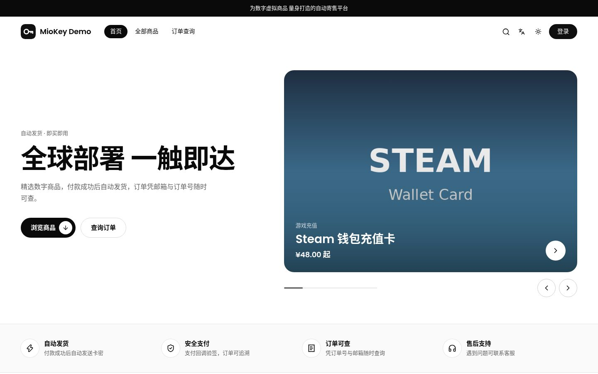 | 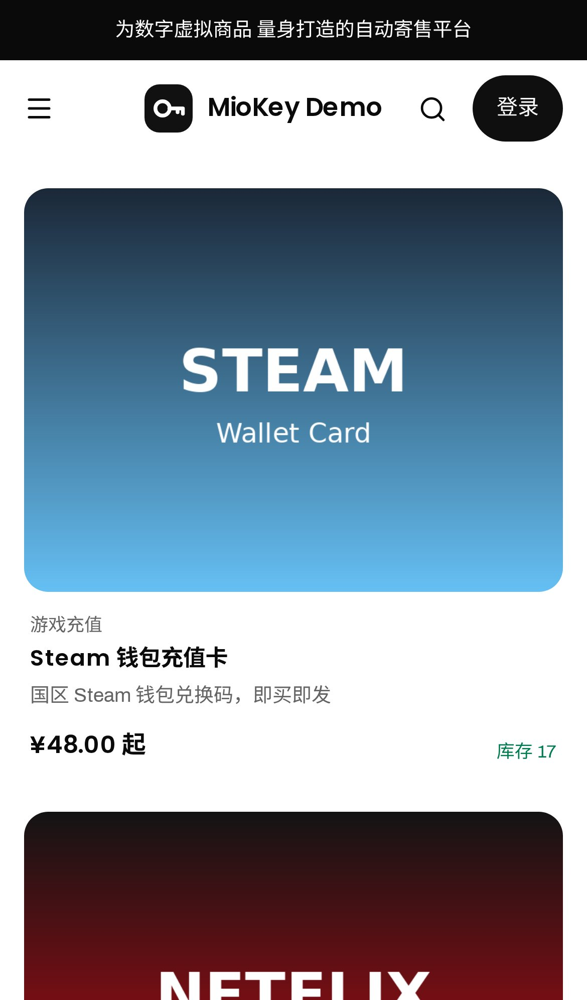 |
| 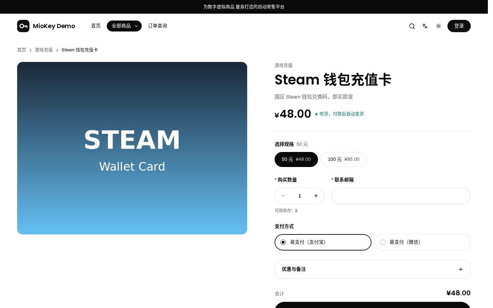 | 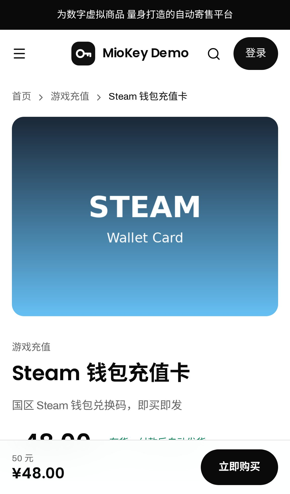 |
| 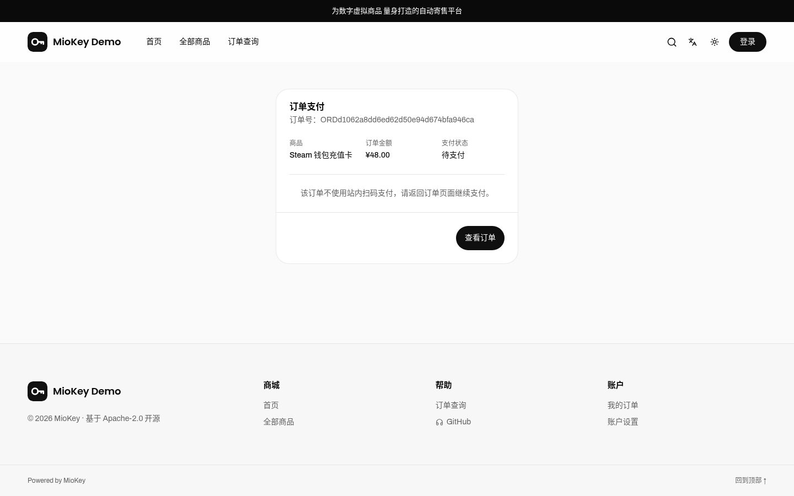 | 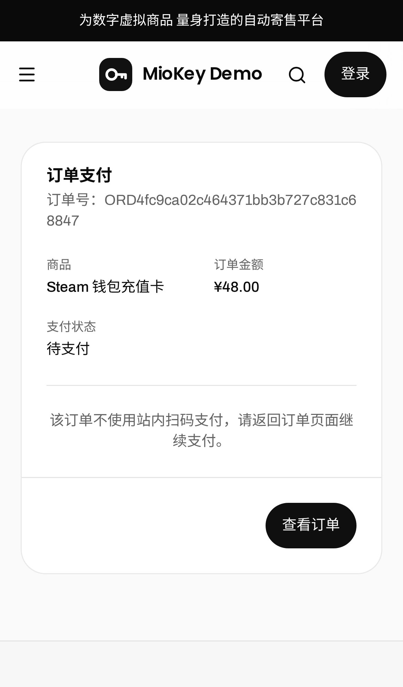 |

### 管理后台

| 桌面 | 手机 |
| --- | --- |
| 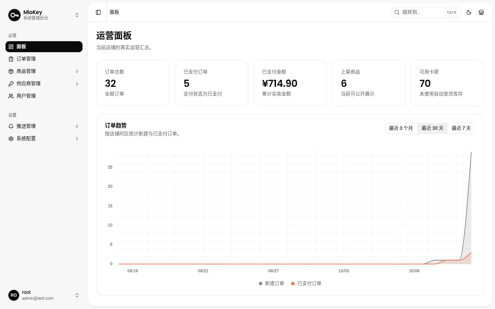 | 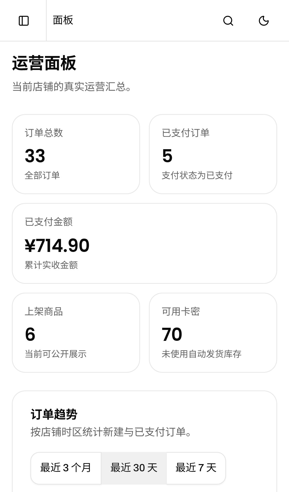 |
| 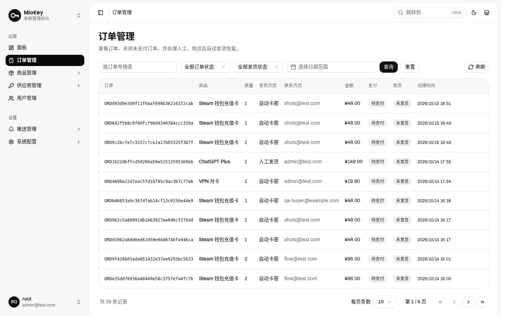 | 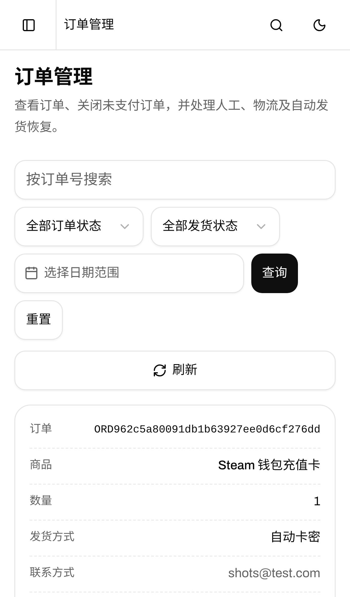 |
| | 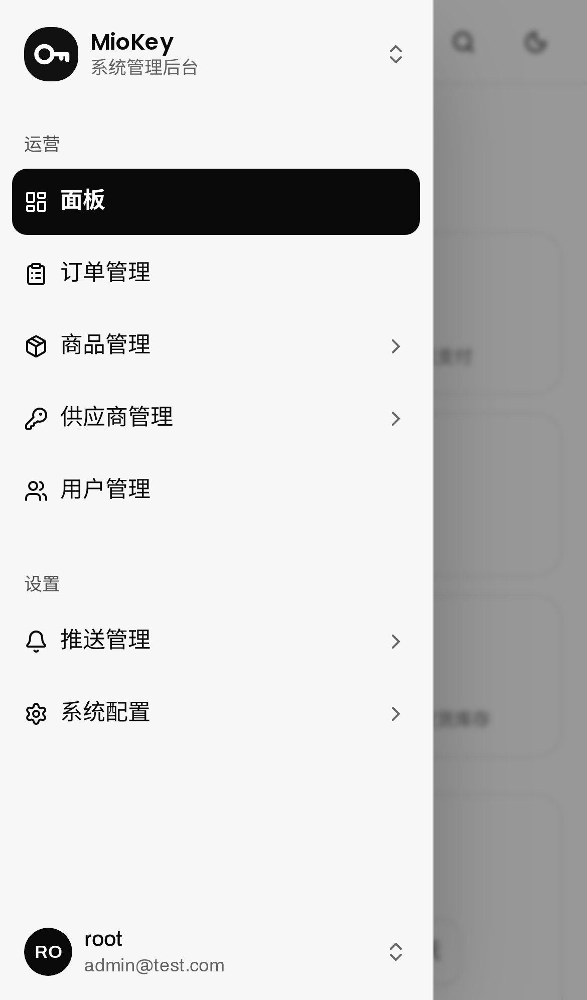 |

## 🎉 核心特性

- ✅ **Cloudflare Workers 部署**：一键部署、流水线更新版本
- ✅ **完整商品体系**：分类、商品上下架、富文本详情、封面图、购买限额与优惠券
- ✅ **上游供应商管理**：支持独角Next、二次元发卡供应商、上游商品导入、供应商绑定、库存与成本同步及自动履约发货
- ✅ **多种交付方式**：卡密自动发货、固定内容发货、人工发货与实物快递发货
- ✅ **支付渠道集成**：支持支付宝、易支付、BEpusdt、Stripe 与 HashPay
- ✅ **订单保障**：支付回调验证、支付日志、超时订单自动关闭与库存/优惠券释放
- ✅ **会员与访客订单**：邮箱密码注册登录、双因素认证、订单查询与访客订单找回
- ✅ **消息通知**：邮件、Telegram、微信三方渠道；支持模板、测试、重试及发送日志
- ✅ **媒体库**：兼容 S3 的对象存储，支持图片与 PDF 上传、站内代理访问及缓存
- ✅ **安全后台**：随机管理路径、首位管理员初始化、敏感配置脱敏保存

## 🚀 一键部署到 Cloudflare Workers

[](https://deploy.workers.cloudflare.com/?url=https://github.com/mio-co/MioKey)

[查看 Cloudflare 部署图文教程](./docs/imgs/wiki/deploy.jpg)

点击按钮后按部署页面提示创建 D1 数据库，并配置以下变量：

| 变量 | 类型 | 说明 |
| --- | --- | --- |
| `ADMIN_PATH` | Secret（推荐） | 后台访问路径，请填写难以猜测的随机字符串，**不含** `/`，例如 `admin-3q9527ko8`。建议设为 Secret：在 Cloudflare 控制台添加的普通变量会在下次 `wrangler deploy`（含推送触发的自动部署）时被清除，导致后台 404。 |
| `BETTER_AUTH_SECRET` | Secret | 登录会话签名密钥。请使用强随机值，可通过 `openssl rand -base64 32` 生成。 |
| `TURNSTILE_SITE_KEY` | 可选普通变量 | Cloudflare Turnstile 站点密钥；启用验证码时必须同时配置 Secret。 |
| `TURNSTILE_SECRET_KEY` | 可选 Secret | Cloudflare Turnstile 密钥；启用验证码时必须同时配置站点密钥。 |

部署完成后：

1. 打开 `https://你的Workers域名/setup`，创建首个 root 管理员账号。初始化完成后该页面将不可再次创建管理员。
2. 访问 `https://你的Workers域名/${ADMIN_PATH}`，使用刚创建的账号登录后台。
3. 进入 `/${ADMIN_PATH}/dash`，先在 **系统配置 → 站点配置** 中完善站点名称、公开地址、公告、客服方式和页脚信息。
4. 配置支付渠道、创建商品并导入卡密或设置发货方式，即可开始使用。

> 一键部署时请保持 `wrangler.jsonc` 中 D1 的 `database_id` 注释状态，由 Cloudflare 部署流程创建和绑定数据库。

### 更新 MioKey 版本

一键部署会在你的 GitHub 账号下创建独立仓库。后续可使用 GitHub Actions 从 `mio-co/MioKey` 同步最新版本。

> [!IMPORTANT]
> 出于 GitHub 安全限制，一键部署创建的仓库**不会自动包含 GitHub Actions 工作流**。请先在你的仓库中手动创建 `.github/workflows/update-miokey.yml`，并复制本项目的 [更新工作流内容](https://github.com/mio-co/MioKey/blob/main/.github/workflows/update-miokey.yml) 后提交。

首次添加完成后：

1. 打开你自己的 GitHub 仓库，进入 **Actions**。
2. 选择 **Update MioKey** 工作流。
3. 点击 **Run workflow**，确认目标分支后运行。
4. 工作流会拉取 `mio-co/MioKey` 的 `main` 分支并推送到你的仓库；Cloudflare 的 Git 集成会自动检测提交并重新部署。

该工作流会保留你仓库当前的 `wrangler.jsonc`，以避免覆盖 D1 绑定和部署配置；除该文件外，同步会覆盖其他未合并的本地改动。对源码做过二次开发时，请先备份或通过分支、PR 合并更新。

## 📃 技术文档

- [开发规范](./docs/dev.md)
- [共用组件规范](./docs/components.md)
- [产品需求（PRD）](./docs/PRD.md) · [界面重做记录](./docs/rework-log.md)
- [Cloudflare Workers 文档](https://developers.cloudflare.com/workers/)
- [Cloudflare D1 文档](https://developers.cloudflare.com/d1/)

### 本地开发

环境要求：Node.js 20+、bun，以及用于本地 D1 的 Wrangler。

```bash
bun i                # 安装项目依赖
bun db:generate      # 已执行迁移 0000_initial.sql 后可跳过；仅修改 schema.ts 后才需要生成新迁移
bun db:migrate:local # 将 migration 应用到本地 Wrangler D1 模拟数据库
bun db:seed:local    # 导入本地默认数据
bun dev              # 启动本地开发服务器
```

默认访问地址为 <http://localhost:3000>。本地开发变量写入未提交的 `.dev.vars`：

```ini
ADMIN_PATH=admin
BETTER_AUTH_SECRET=local-development-secret
# TURNSTILE_SITE_KEY=your-site-key
# TURNSTILE_SECRET_KEY=your-secret-key
```

常用命令：

```bash
bun run lint              # ESLint 检查
bun run db:check          # 检查 Drizzle migration
bun run build             # 生成 migration 并构建
bun run db:migrate:remote # 应用远程 D1 migration
bun run deploy            # 迁移、导入默认数据并部署
```

## 🔧 技术栈

- **前端**：Vike、Vue 3、Vite、Tailwind CSS v4、shadcn-vue（Reka UI）、embla-carousel-vue
- **服务端**：Hono + Cloudflare Workers
- **数据库**：Cloudflare D1 + Drizzle ORM
- **认证**：Better Auth（邮箱密码与双因素认证）
- **部署与任务**：Wrangler、Cloudflare Cron Trigger
- **文件存储**：S3 兼容对象存储

## ❓ 常见问题

- **后台无法访问**：确认地址是 `/${ADMIN_PATH}`，并检查部署时填写的 `ADMIN_PATH` 是否正确。如果之前能访问、重新部署后变成 404，多半是 `ADMIN_PATH` 以普通变量添加后被部署清掉了，请改为以 Secret 类型重新添加。
- **首次部署没有管理员**：访问 `/setup` 创建首个管理员；仅未初始化时可用。
- **支付回调失败**：在“系统配置 → 站点配置”中设置正确的公开站点地址，再检查对应支付渠道的回调地址和密钥。
- **邮件通知没有发送**：先在“推送管理 → 电子邮件 → 通道配置”创建、测试并启用一个邮件 Provider，然后检查推送设置与模板。
- **媒体上传失败**：在“系统配置 → 媒体存储”配置 S3 兼容端点、Bucket 和访问凭据，并使用“测试连接”验证 PUT、读取和删除权限。

## 🧬 基于 34892002/cffk 修改

MioKey 是 [CFFK](https://github.com/34892002/cffk)（作者 34892002 / ggyy 及贡献者，Apache-2.0）的修改版本，遵循 Apache License 2.0 发布：

- 保留原项目的 [LICENSE](./LICENSE)，并在 [NOTICE](./NOTICE) 中注明原作者与修改说明；
- 本仓库的修改主要集中在前端：前台商城与管理后台的视觉、布局、交互、移动端适配和品牌（名称、Logo、链接）；
- 支付、订单、发卡、认证、数据库结构与迁移、供应商同步、定时任务等服务端逻辑沿用上游实现，未改变行为；
- 服务端仅有少量与界面相关的只读改动：品牌字符串与默认值、只读的 `GET /sitemap.xml` 与 `GET /robots.txt`（带 Sitemap 地址）、首页商品卡按全部规格汇总库存的只读查询；
- “CFFK” 名称与原 Logo 属于原项目，MioKey 不使用它们。

感谢原作者的开源工作。

## 🙏 致谢

MioKey 基于 [CFFK](https://github.com/34892002/cffk) 与其前身 [EdgeKey](https://github.com/34892002/edgeKey)，感谢它们的作者、协作者与社区。

感谢 [Linux.do](https://linux.do/) 与 [NodeSeek](https://www.nodeseek.com/) 社区的支持。

感谢下列开源项目：

- [BEpusdt](https://github.com/v03413/BEpusdt) — 加密货币交易支持
- [HashPay](https://github.com/TGDash/HashPay) — 运行在 Cloudflare Workers 上的加密货币收款网关
- [worker-mailer](https://github.com/zou-yu/worker-mailer) — Workers 环境 SMTP 邮件支持
- [Cloudflare Workers](https://workers.cloudflare.com/) — 边缘计算平台

## 🏝️ 上游社区

MioKey 暂无独立社区；以下为上游 EdgeKey 作者的 Telegram：

- Telegram 群组：https://t.me/edgeKeyChannel
- Telegram 频道：https://t.me/edgeKeyGroup
